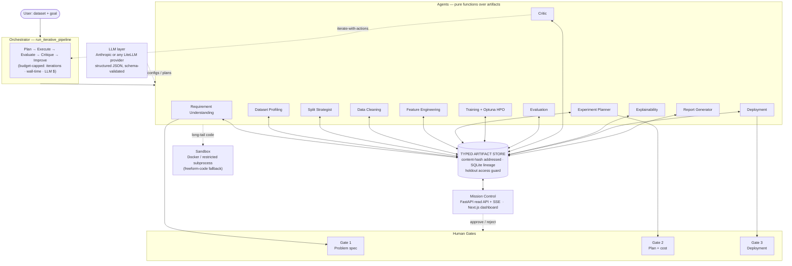

# AI ML Engineering Team

**A platform that behaves like an autonomous ML engineering team — not an AutoML tool.**

You upload a dataset and describe your goal in plain English. A coordinated set
of specialized LLM agents then does what a careful ML team would: they interpret
the goal into a precise problem, profile and clean the data, engineer features,
plan and run experiments, evaluate rigorously, *critique their own results*,
iterate to improve, and finally package a deployable model with explainability
and human-readable reports. You stay in control through three approval gates, and
you watch the whole thing happen live in a mission-control dashboard.

It handles **five task families** — binary / multiclass classification,
regression, **time-series forecasting** (chronological splits, lag features,
prediction intervals), and **labeled anomaly detection** (fraud, defects,
predictive-maintenance failure events) — with a registry of **20 vetted model
templates** the planner agent chooses from per dataset.

It is built to the standard of a real production system: every decision is a
typed, logged, reproducible artifact; the evaluation is leakage-proof by
construction; and nothing ships without a human signing off.

---

## What makes this different from AutoML

| AutoML tool | This platform |
|---|---|
| A black box: data in, model out | A transparent **team of agents**, each a pure function you can inspect |
| Searches hyperparameters | **Reasons** about the problem, proposes domain features, critiques its own output, and iterates with a plan |
| You trust the number it prints | A separate **Critic** agent must clear deterministic safety gates before anything is "approved" |
| Leakage is on you | The holdout set is **frozen at ingestion and physically unreadable** until the final report — enforced at the storage layer, not by convention |
| No audit trail | Every artifact is **content-addressed with full lineage**; every run has a complete trace |
| Runs unattended | **Three human gates**: confirm the problem, approve the plan + cost, sign off on deployment |

---

## How it works

The system is organized as a **hub-and-spoke** around a single typed artifact
store. Agents never talk to each other directly — every agent is a pure function
of the form `typed artifacts in → typed artifacts out`, and *all* handoffs go
through the store. This is what makes the system inspectable, resumable, and
impossible to get into a tangled state.



**A run, step by step:**

1. **Requirement Understanding** turns your goal + the dataset's columns into a
   precise `ProblemSpec` (task type, target, primary metric, cost asymmetry).
   → **Gate 1**: you confirm it.
2. **Ingest → Profile → Split** load the data, compute a deterministic profile,
   and carve off a **frozen holdout** that is immediately locked by the store guard.
3. **Cleaning** and **Feature Engineering** agents propose *whitelisted,
   justified* operations; deterministic code executes them. The feature executor
   applies only row-local, fold-safe ops (ratios, differences, log transforms,
   datetime decomposition, …) and **loudly drops** anything that would learn
   statistics across CV folds — every drop is recorded with its reason.
   For forecasting, deterministic lag / rolling / calendar features are added
   and the holdout becomes the *chronological tail* (never shuffled).
4. **Experiment Planner** picks from the 20-template registry — gradient
   boosting (LightGBM/XGBoost/CatBoost), TabPFN, forests, linear/SVM/KNN/NB/MLP,
   stacked ensembles, dedicated anomaly detectors, seasonal-naive and quantile
   forecasters — cheap baselines always first. → **Gate 2**: you approve the
   plan and its cost estimate.
5. **Training** runs each experiment with cross-validation (preprocessing refit
   *inside every fold*, so no leakage), tuning with **Optuna** (ASHA pruning).
6. **Evaluation** computes CV metrics, baseline deltas, and leakage detectors —
   all deterministic, no LLM.
7. **Critic** reads *only* the structured evaluation report and issues a verdict:
   **approve**, **iterate-with-actions**, or **halt**. It cannot approve past a
   failed hard gate — code overrides it if it tries.
8. On *iterate*, the **loop** tunes the best model further and asks the planner
   for new candidates addressing the critique — repeating under an explicit budget.
9. **Explainability** produces permutation importance, partial-dependence, and
   SHAP figures (on training data only).
10. **Deployment** packages the full pipeline + a Pandera inference schema + a
    generated FastAPI app + Dockerfile + a drift baseline. → **Gate 3**: you sign off.
11. **Report Generator** — the *only* component allowed to read the frozen
    holdout, and only through the guard's `final_reporting_access` — computes true
    out-of-sample metrics and renders business + technical HTML reports.

Throughout, **Mission Control** streams the live state to your browser: agents
light up as they work, the activity feed scrolls, cost meters tick, and the gates
wait for your click.

---

## Task types & model catalog

| Task type | When | Special handling |
|---|---|---|
| Binary / multiclass classification | Labeled categories | Stratified splits; ROC-AUC, **PR-AUC**, F1, log-loss |
| Regression | Numeric target | KFold CV; RMSE/MAE/R² |
| **Forecasting** | Future values of a time series | Chronological holdout (never shuffled), `TimeSeriesSplit` CV, lag/rolling/calendar features, seasonal-naive floor, quantile intervals |
| **Anomaly detection** | Rare labeled events (fraud, failures) | PR-AUC headline metric; unsupervised detectors fit on normal rows, scored against labels |

**20 vetted templates** (the LLM picks *which* to run, never writes model code):
dummy floor · LightGBM · XGBoost · CatBoost · TabPFN v2 · random forest ·
extra trees · AdaBoost · logistic/ridge linear · SVM · KNN · Gaussian NB · MLP ·
stacking ensemble · **deep stack** (5 base families + passthrough, AutoGluon-style) ·
isolation forest · one-class SVM · local outlier factor · **seasonal naive**
(the honest forecasting floor) · **LightGBM quantile trio** (5/50/95% prediction
intervals). Optuna search spaces are vetted per-family; the LLM never invents
ranges.

Predictive-maintenance goals map automatically: *"will it fail within X?"* →
anomaly / binary classification with cost asymmetry; *"remaining useful life?"*
→ regression / forecasting.

---

## Core principles (non-negotiable)

1. **Hub-and-spoke around a typed artifact store** — no prose passed between agents; only typed, validated artifacts.
2. **Agents decide, libraries execute** — the LLM selects from vetted, parameterized templates and fills configs; freeform LLM code is a *sandboxed* fallback for the long tail only.
3. **LLM plans, code runs** — the LLM proposes; a deterministic orchestrator owns execution, the iteration loop, and budget accounting. (Prefect 3 wraps the deterministic path for caching/resumption; it is not the LLM's runtime.)
4. **Leakage-proof evaluation** — the holdout is created at ingestion and made **unreadable at the storage layer** until the final report; all preprocessing is fit inside CV folds.
5. **Everything reproducible** — pinned seeds, a uv lockfile, dataset content hashes, and the full config logged per run. Re-running a run gives bit-identical results.
6. **Human gates** at problem spec, training plan (with cost), and pre-deployment.
7. **Every cleaning / transform decision** is a logged, reversible, declarative operation with a recorded justification — never a mutation of source data.

---

## Quickstart

**Requirements:** Python 3.11+ and [uv](https://docs.astral.sh/uv/). Node 18+ only if you want the dashboard.

```bash
# Install everything
uv sync --all-groups

# Run the test suite (238 tests) and the linter
uv run pytest
uv run ruff check .
```

### Run a full pipeline from the command line

```bash
uv run python examples/run_example.py
```

This ingests the example churn dataset, runs the deterministic pipeline
end-to-end, and prints CV metrics, baseline deltas, and the leakage-check results.

### Run the Mission Control dashboard (the full experience)

Two processes — the API and the web app:

```bash
# 1. API (from the repo root). Seeds a completed demo run on first start,
#    so every page is populated immediately — no API key needed.
uv run uvicorn mlteam.api.app:app --port 8000

# 2. Dashboard (from dashboard/)
cd dashboard
npm install        # first time only
npm run dev        # → http://localhost:3000
```

Open http://localhost:3000. Launch a run, watch the agents work live, approve at
the gates, and read the reports. Live runs use Claude if `ANTHROPIC_API_KEY` is
set; otherwise everything falls back to a recorded fixture, so the whole thing
works with **no credentials**. See [dashboard/README.md](dashboard/README.md).

### Benchmark regression suite

```bash
uv run python -m benchmarks.run_benchmarks
```

Runs the pipeline over 7 pinned datasets and compares against stored reference
scores — the guardrail that catches any regression from future changes.

---

## Repository layout

```
src/mlteam/
  contracts/        Pydantic artifact schemas — the only currency agents exchange
  store/            content-addressed artifact store + SQLite lineage + holdout guard
  llm/              structured-output LLM client, cost tracking, transports
                    (Anthropic SDK, LiteLLM for any provider, fixture replay)
  agents/           the agents — each a pure function over artifacts
  templates/        registry of vetted sklearn-pipeline templates
  evaluation/       metrics, deterministic leakage checks, report assembly
  orchestration/    the iterative loop, budget accounting, human gates, Prefect flows
  sandbox/          SandboxRunner for LLM-generated code (Docker + subprocess fallback)
  serving/          Pandera inference schema, FastAPI app + Dockerfile generators
  reporting/        Plotly figures + Jinja2 business/technical HTML reports
  api/              read-only FastAPI over the store + live SSE run stream (dashboard backend)
  observability/    structured logging, per-run tracing, MLflow wiring
dashboard/          Next.js + TypeScript Mission Control web app
benchmarks/         benchmark harness + pinned datasets + reference scores
tests/              238 tests — unit, integration, end-to-end (no live API needed)
examples/           sample datasets + a runnable example
```

---

## Tech stack

- **Core:** Python 3.11, `uv` (locked deps), Pydantic v2 everywhere, `ruff`, `pytest`.
- **Data & ML:** Polars + pandas, scikit-learn Pipelines, LightGBM, XGBoost, CatBoost, TabPFN, Optuna (ASHA pruning), SHAP, Pandera, Evidently.
- **LLM:** Anthropic SDK or any LiteLLM provider — every call returns JSON validated against a Pydantic schema, with retry-on-error-feedback and full cost/token/latency tracing.
- **Orchestration:** a plain-Python iterative loop with budget accounting; Prefect 3 for caching/resumption of the deterministic path.
- **Serving:** generated FastAPI app that loads the full pipeline and validates inputs with the *same* Pandera schema used in training (kills train/serve skew) + generated Dockerfile.
- **Dashboard:** FastAPI read API with a live SSE stream + a Next.js / TypeScript / Tailwind / Framer Motion / Plotly control room.
- **Tracking:** MLflow (local SQLite backend); structured JSON logging + a per-run trace.

---

## Build status — all 6 phases complete ✅

| Phase | What it delivers |
|---|---|
| **0 — Skeleton & contracts** | 15 typed artifact contracts, content-addressed store, SQLite lineage, the holdout access guard, logging + tracing. |
| **1 — Deterministic pipeline (no LLM)** | Ingest → profile → split (frozen holdout) → clean → dummy/LightGBM/TabPFN baselines → evaluation with leakage checks. Proven: leaky-fixture detection, holdout-untouched assertion, two-run bit-identical reproducibility. |
| **2 — Benchmarks** | One-command regression suite over 7 pinned datasets (binary/multiclass/regression, imbalanced, datetime). Scores reproduce to delta +0.0000. |
| **3 — LLM layer & agents** | Schema-validated structured-output client with cost tracing + fixture replay; 5 agents (Requirement, Cleaning, Feature, Planner, Critic); human gates 1 & 2. |
| **4 — Iteration loop + HPO + sandbox** | Budget-capped Plan→Execute→Evaluate→Critique→Improve loop; Optuna ASHA HPO; a plan-revision agent; `SandboxRunner` (Docker + restricted-subprocess fallback); provider-agnostic LiteLLM. |
| **5 — Explainability, deployment, reports** | SHAP/PDP/permutation figures; deployment bundle behind Gate 3 (pipeline + Pandera inference schema + FastAPI app + Dockerfile + Evidently drift baseline); Jinja2+Plotly HTML reports (the only holdout reader). |
| **6 — Mission Control dashboard** | FastAPI read API + live SSE stream + a bespoke Next.js control room: animated agent-flow X-ray, activity feed, experiment leaderboard, lineage explorer, trace timeline, approval gates, inline reports. |
| **Post-phase expansions** | Model catalog 3 → **20 templates** (XGBoost/CatBoost/forests/linear/SVM/KNN/NB/MLP + stacked & deep-stacked ensembles); **forecasting** task type (temporal splits, lag features, seasonal-naive floor, quantile intervals); **anomaly detection** task type (IsolationForest/OC-SVM/LOF + PR-AUC); the **feature-plan executor** (LLM proposals now execute — row-local fold-safe ops only, stat-learning ops dropped loudly). |

### Notes & deliberate deviations from the original spec

- **Dashboard is Next.js + FastAPI.** The centerpiece is a *live,
  animated* agent-flow visualization, which Streamlit cannot render well — so the
  dashboard is a real web front end over a thin read API. (Approved deviation.)
- **Prefect 3.x** is used (Prefect 2.x is end-of-life). It wraps the deterministic
  path for caching/resumption; the iterative loop itself is plain Python.
- **Docker** is optional. When absent, the sandbox uses a documented, loudly-logged
  restricted-subprocess fallback with resource limits (the Docker path is still
  implemented and auto-selected when Docker is present).
- **TabPFN** ships as a core dependency; LiteLLM is an optional extra
  (`uv sync --extra litellm`).
