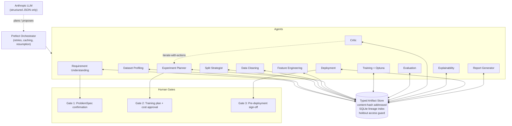

# AI ML Engineering Team

A production-grade agentic platform that behaves like an autonomous ML engineering
team — not an AutoML tool. Upload a dataset, describe your goal in natural language,
and an LLM planner coordinates specialized agents that profile, clean, engineer
features, train, evaluate, critique, iterate, and produce deployment assets and reports.

## Architecture

Hub-and-spoke around a typed artifact store. Agents never talk to each other
directly: every agent is a pure function `typed artifacts in → typed artifacts out`,
and all handoffs go through the store.



Core principles (non-negotiable):

1. **Hub-and-spoke around a typed artifact store** — no prose-passing between agents.
2. **Agents decide, libraries execute** — LLM fills configs for vetted pipeline templates; freeform code is a sandboxed fallback.
3. **LLM plans, orchestrator runs** — Prefect owns execution, retries, caching, resumption.
4. **Leakage-proof evaluation** — frozen holdout created at ingestion, unreadable (enforced at store level) until final reporting; all preprocessing fit inside CV folds.
5. **Everything reproducible** — pinned seeds, uv lockfile, content hashes, full config per run.
6. **Human gates** at problem spec, training plan, and pre-deployment.
7. **Every cleaning/transform decision** is a logged, reversible, declarative op with a justification.

## Quickstart

```bash
# Install (Python 3.11+, uv required)
uv sync --all-groups

# Run tests
uv run pytest

# Lint
uv run ruff check .
```

A full example run (dataset upload → goal → report) lands in later phases; see
`examples/` as phases complete.

## Repository layout

```
src/mlteam/
  contracts/        Pydantic artifact schemas (one module per artifact type)
  store/            artifact store + SQLite lineage index + holdout guard
  llm/              Anthropic client wrapper, structured output, cost tracking (Phase 3)
  agents/           agents as pure functions over artifacts (Phases 1, 3)
  templates/        registry of vetted pipeline templates (Phase 1)
  orchestration/    Prefect flows, DAG builder, iteration loop (Phase 1, 4)
  sandbox/          SandboxRunner for LLM-generated code (Phase 4)
  evaluation/       metrics, leakage checks, slice analysis (Phase 1)
  serving/          FastAPI app + Dockerfile generators (Phase 5)
  reporting/        HTML report builder (Phase 5)
  dashboard/        Streamlit app (Phase 6)
  observability/    structured logging, run tracing, MLflow wiring
benchmarks/         benchmark harness + reference scores (Phase 2)
tests/              unit + integration tests
examples/           sample datasets + goal prompts
```

## Build status

- **Phase 0 — Skeleton & contracts** ✅: repo scaffold, all artifact
  contracts, artifact store with lineage index and holdout guard, MLflow wiring,
  structured logging + tracing, tests.
- **Phase 1 — Deterministic tabular pipeline (no LLM)** ✅: ingest → profile →
  split (frozen holdout) → structural cleaning → dummy/LightGBM/TabPFN baselines
  (preprocessing inside CV folds) → EvaluationReport with leakage checks, as a
  Prefect flow with content-based caching. Proven: leaky-fixture detection,
  holdout-untouched assertion, two-run bit-identical reproducibility.
  Try it: `uv run python examples/run_example.py`
- **Phase 2 — Evaluation harness & benchmarks** ✅: 7 pinned datasets
  (binary/multiclass/regression, imbalanced, datetime), stored reference scores,
  one-command regression gate: `uv run python -m benchmarks.run_benchmarks`.
  Scores reproduce with delta +0.0000.
- **Phase 3 — LLM layer & first agents** ✅: Anthropic client with structured
  JSON validated against Pydantic schemas (retry with error feedback, max 3),
  full cost/token/latency tracing per call; fixture record/replay transports
  (tests never hit the live API). Five agents: Requirement Understanding,
  Cleaning proposer (whitelisted ops), Feature proposer, Experiment Planner
  (baselines-first enforced), Critic (deterministic quantitative gates — the
  LLM can never approve past a failed hard gate). Human gates 1 & 2 wired
  (Prefect pause / console / auto-approve backends) in `run_agentic_pipeline`.
- Phase 3 — LLM layer & first agents
- **Phase 4 — Iteration loop + HPO + sandbox** ✅: budget-capped
  Plan→Execute→Evaluate→Critique→Improve loop (`run_iterative_pipeline`) with
  explicit iteration/wall-time/LLM-cost accounting; Optuna HPO with
  successive-halving (ASHA) pruning over vetted search spaces; a plan-revision
  agent that proposes new candidates from critique actions; and a
  `SandboxRunner` for LLM-generated code — Docker (`--network=none`, read-only
  mounts, resource caps) with a loud restricted-subprocess fallback (scrubbed
  env, private data copies, process-tree wall-clock kill). Provider-agnostic
  LLM access via `LiteLLMTransport` (`uv sync --extra litellm`) — the same
  agents run on any LiteLLM-supported provider.
- **Phase 5 — Explainability, deployment, reports** ✅: explainability agent
  (permutation importance + partial dependence + best-effort SHAP → Plotly JSON
  figure artifacts, on train data only); deployment bundle behind Human Gate 3 —
  full serialized pipeline + a Pandera inference schema (the *same* one enforced
  at serving, killing train/serve skew) + a generated FastAPI app + Dockerfile +
  an Evidently drift baseline; `materialize_bundle` writes a runnable serving
  directory; and Jinja2+Plotly business/technical HTML reports. The report
  generator is the only component that reads the frozen holdout — and only
  through the store guard's `final_reporting_access` — to report true
  out-of-sample metrics.
- **Phase 6 — Mission Control dashboard** ✅: a read-only FastAPI layer
  (`src/mlteam/api/`) over the artifact store, lineage, and run traces — with a
  live SSE stream, CSV-upload launch, and the three human-gate actions — plus a
  bespoke **Next.js + TypeScript** control room (`dashboard/`): an animated
  hub-and-spoke agent-flow X-ray, a streaming activity feed, the experiment
  leaderboard, the artifact-lineage explorer, the trace timeline, the approval
  gates, and inline business/technical reports. Deviates from the spec's
  Streamlit (deliberately — the live animation needs a real front end).
  Run: `uv run uvicorn mlteam.api.app:app --port 8000` + `cd dashboard && npm run dev`.
  See [dashboard/README.md](dashboard/README.md).

### Environment notes

- Docker is not available on this development machine; the Phase 4 sandbox will use
  the documented **restricted-subprocess fallback** (loudly logged). The Docker path
  is still implemented and auto-selected when Docker is present.
- Prefect 3.x is used (Prefect 2.x is end-of-life); TabPFN ships as a core dependency.
